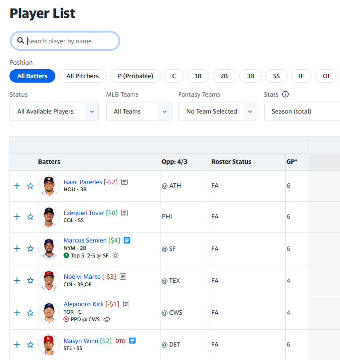
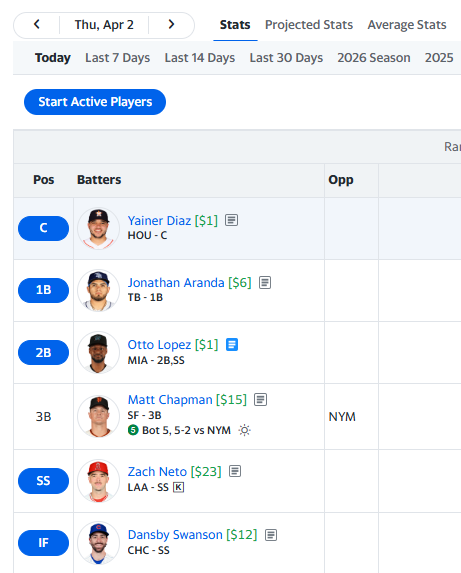

# YFanValue

Chrome extension for Yahoo Fantasy Baseball pages that injects player dollar values next to player links.  Provide up to two urls that return a structure JSON object with specific values. When you are viewing Player information in Yahoo Fantasy, dollar values from those urls are used and matched by player using YAHOOID. Negative player values are colored in Red and positive values are colored Green.

Example usage, use one URL for Pre-draft Dollar values and second url for current dollar value of players.  

## Features

- Fetches player values from remote JSON feeds
- Injects values into Yahoo Fantasy Baseball player listings
- Includes an options page for configuring feed URLs
- Uses Manifest V3, Vite, TypeScript, Tailwind CSS, and Zod

## Screenshots




*Player values displayed on Yahoo Fantasy Baseball page*

## Requirements

- Node.js 20.19+ or 22.12+ recommended
- Google Chrome or another Chromium-based browser

The project currently builds under Node.js 18 in this repo, but Vite warns that newer Node versions are preferred.

## Development

Install dependencies:

```bash
npm install
```

Start the dev server:

```bash
npm run dev
```

Run the type checker:

```bash
npm run typecheck
```

Run automated tests:

```bash
npm run test
```

Create a production build:

```bash
npm run build
```

GitHub Actions runs the tests, type checker, build, and security checks for
pull requests and pushes to `main`. Successful runs include a downloadable
`yfan-value` ZIP artifact that is retained for 14 days.

## Security Checks

Install [Gitleaks](https://github.com/gitleaks/gitleaks) and
[Semgrep](https://semgrep.dev/docs/getting-started/) and make sure both commands
are available on your `PATH`.

Run the complete local security baseline:

```bash
npm run security
```

This checks dependencies for known vulnerabilities, verifies npm package
signatures and provenance, scans Git history for secrets, and analyzes the
source code for security issues. Run an individual check with one of:

```bash
npm run security:dependencies
npm run security:signatures
npm run security:secrets
npm run security:code
```

## Load The Extension

1. Run `npm run build`.
2. Open `chrome://extensions`.
3. Enable Developer Mode.
4. Click `Load unpacked`.
5. Select the `dist` directory from this project.

## Feed Format

Configured feed URLs should return a JSON array of objects containing:

- `YAHOOID`
- `Dollars`

Example:

```json
[
  {
    "YAHOOID": "10835",
    "Dollars": 63
  },
  ...
]
```

## Project Structure

- `src/background/`: background service worker
- `src/content/`: content script that injects values into Yahoo pages
- `src/options/`: options page UI
- `src/shared/`: shared config, types, and data helpers
- `test/`: automated tests

## License

MIT. See [LICENSE](/mnt/f/Projects/YahooPlayerValues/LICENSE).
